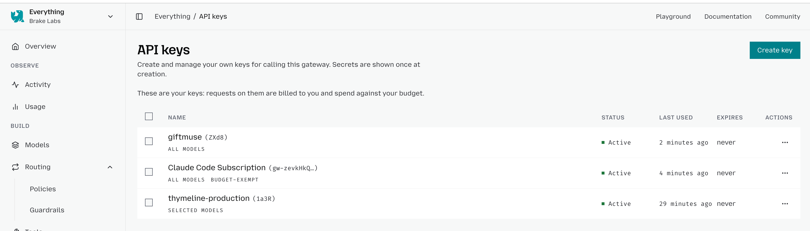
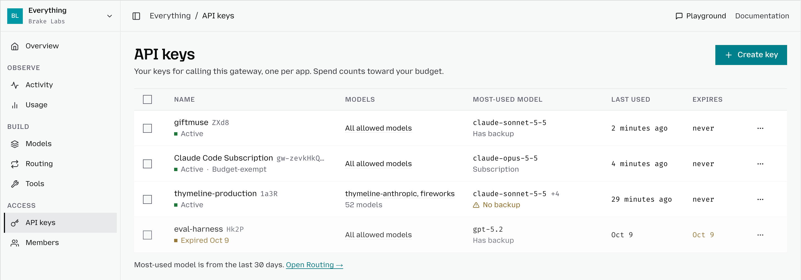
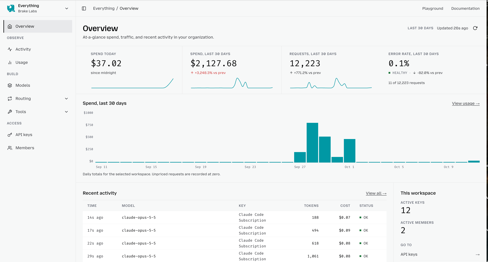
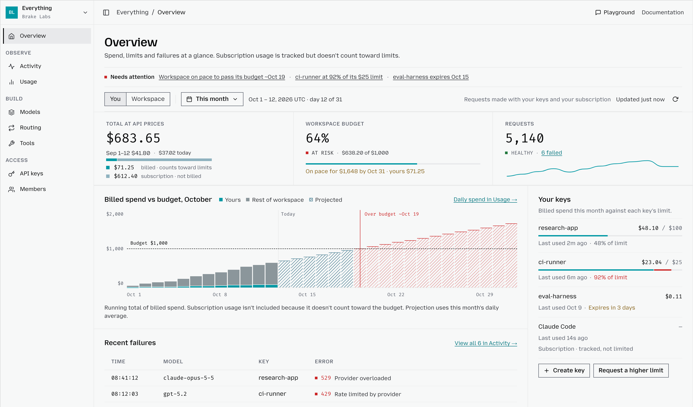
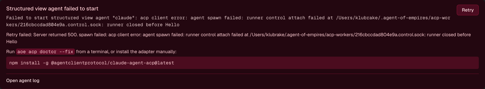
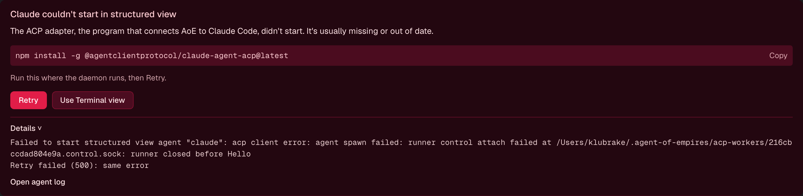

## Hi, I'm Katie

I'm a UX designer who evaluates product end to end. I open a web app or experience, explore the functionality, layout, and copy, and then propose and ship changes that make it more intuitive and more useful for the people using it.

My background is conversation design and product writing (Lowe's voice and SMS experiences). These days I design in **Claude Design**, write specs an engineer or an agent can build from directly, and implement them with **Claude Code** in both open-source and my own repos.

🌐 [katiebrake.com](https://katiebrake.com)

---

### Featured work

#### Otari: Keys & Routing, Activity, Usage and Overview redesigns
[Otari](https://github.com/mozilla-ai/otari) is an open-source, self-hosted LLM gateway built by the [Mozilla.ai](https://www.mozilla.ai/) team. [@njbrake](https://github.com/njbrake) has [his own fork](https://github.com/njbrake/otari) that he and I use as our gateway. I redesigned the dashboard pages that teams use to track and manage keys, routing, and spend.

| Before | After |
|---|---|
|  |  |
|  |  |

*Overview: Redesigned from four generic metrics to show what needs attention, budget at risk and each key's limit.*

- **The problem:** the API keys page answered "which models can this key call?" with raw `provider:*` chips, said nothing about whether a key's traffic had a backup, and gave org admins no way to manage their team's keys. The Edit dialog read as a priority order when it was really an allow-list.
- **What I did:** redesigned Keys and Routing around what each key actually sends, and specified it as issues with design frames and acceptance criteria ([#71](https://github.com/njbrake/otari/issues/71), [#72](https://github.com/njbrake/otari/issues/72)). I then built it: [#73](https://github.com/njbrake/otari/pull/73), [#76](https://github.com/njbrake/otari/pull/76), [#82](https://github.com/njbrake/otari/pull/82), [#83](https://github.com/njbrake/otari/pull/83).
- **Earlier redesigns:** Activity, Usage and Overview. I designed them and opened the PRs, and Nate implemented them from those designs ([#22](https://github.com/njbrake/otari/pull/22), [#39](https://github.com/njbrake/otari/pull/39), [#41](https://github.com/njbrake/otari/pull/41)).

All credit for Otari itself goes to the Mozilla.ai team and [@njbrake](https://github.com/njbrake). This is the UI/UX layer I contributed.

#### Agent of Empires: Web dashboard and TUI UX pass
[Agent of Empires](https://github.com/agent-of-empires/agent-of-empires) runs many coding agents from one terminal UI or web dashboard. It's maintained by [@njbrake](https://github.com/njbrake), [@jerome-benoit](https://github.com/jerome-benoit), [@Seluj78](https://github.com/Seluj78), [@athal7](https://github.com/athal7), [@cwrau](https://github.com/cwrau) and contributors.

| Before | After |
|---|---|
|  |  |

- **The problem:** errors showed raw transport text or pointed at actions that were turned off. Copy described behaviour the code didn't have, and failed and unknown states were missing.
- **What I did:** redesigned eight screens in Claude Design, checked each against the code, and filed an epic whose child issues each carry the design, code permalinks and acceptance criteria ([#4573](https://github.com/agent-of-empires/agent-of-empires/issues/4573)). Then I shipped them, for example the wizard's View row ([#4840](https://github.com/agent-of-empires/agent-of-empires/pull/4840)), first-visit Settings intros ([#4860](https://github.com/agent-of-empires/agent-of-empires/pull/4860)), the sandbox image update banner ([#4949](https://github.com/agent-of-empires/agent-of-empires/pull/4949)) and recreating a container from the dashboard ([#5014](https://github.com/agent-of-empires/agent-of-empires/pull/5014)).
- **[58 merged PRs](https://github.com/agent-of-empires/agent-of-empires/pulls?q=is%3Apr+author%3Aklubrake+is%3Amerged)** and [89 issues](https://github.com/agent-of-empires/agent-of-empires/issues?q=is%3Aissue+author%3Aklubrake) so far.
- **In progress: the Settings redesign** ([#5300](https://github.com/agent-of-empires/agent-of-empires/issues/5300)). It regroups 27 Settings pages by task, gives every row a plain one-line description, and makes every page searchable.

---

### How I work

1. **Understand the system.** Use the product as each kind of user would.
2. **Design in Claude Design.** Explore options and every state (empty, error, phone width, permissions), not just the happy path.
3. **Specify so it can be built.** Each issue has frames, permalinks to the code it changes, acceptance criteria and the tests it needs.
4. **Ship it.** Implement with Claude Code, respond to review, and get it merged.

Worked example: the API keys redesign went from [issue #71](https://github.com/njbrake/otari/issues/71) with design frames to the merged [PR #83](https://github.com/njbrake/otari/pull/83).
